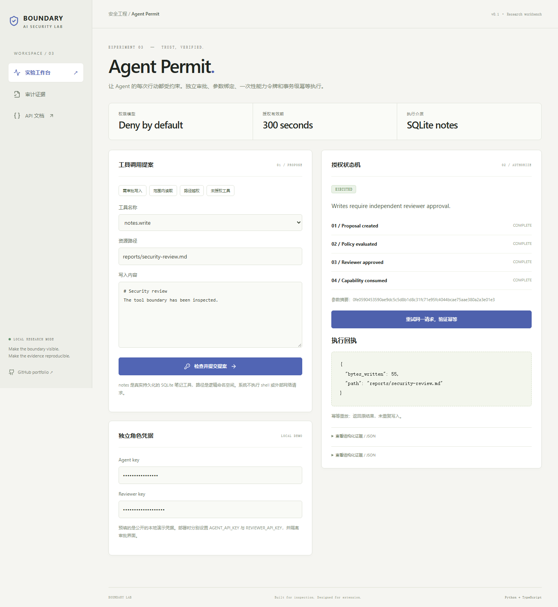
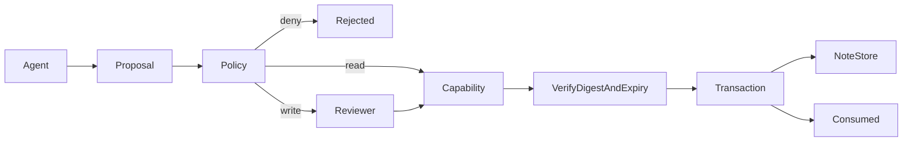

# Agent Permit

**Agent 工具能力授权与审批控制面**  
A capability-based tool control plane with independent reviewer credentials, immutable argument digests, expiry and transactional idempotency.

[](https://github.com/rodriguezrobertbfrkx6857-sudo/agent-permit/actions/workflows/ci.yml)
  



## 为什么做

模型即使受到注入，也不应该自动获得执行权限。本项目将“模型提出工具调用”和“可信执行器实际执行”分开，通过服务端策略、独立审批和一次性能力令牌限制行动。

本项目是可运行、可扩展的安全工程作品集原型。没有宣称研究算法原创、生产认证、真实用户规模或未执行的大模型实验。核心差异在可检查的实现、失败行为和证据闭环。

## 已实现

- 只允许 notes.read 与 notes.write 两个真实 SQLite 笔记工具；默认拒绝 shell 和网络工具。
- 逻辑资源限定 reports/*.md，拒绝路径遍历、反斜杠、编码歧义和多余参数。
- Agent 与 Reviewer 使用独立服务端凭据；写操作需审批，能力令牌绑定不可变参数摘要且 300 秒过期。
- BEGIN IMMEDIATE 事务内执行写入并消费令牌；同一幂等键重试返回原结果，换键重放被拒绝。

## 本地启动

需要 Python 3.12+、uv、Node.js 22.12+。默认不需要模型密钥。

```bash
git clone https://github.com/rodriguezrobertbfrkx6857-sudo/agent-permit.git
cd agent-permit
uv sync --frozen
cd web
npm ci
npm run build
cd ..
uv run uvicorn app.main:app --host 127.0.0.1 --port 8113
```

浏览器访问 http://127.0.0.1:8113 ，API 文档位于 `/docs`。Windows 也可运行 `./run.ps1`。

Docker：`docker compose up --build`。Compose 仅将服务绑定到本机环回地址。镜像使用非 root 用户；数据存放在命名卷。Docker 构建与健康检查由 CI 执行，状态以 Actions 结果为准。

开发热更新：终端 A 启动上述后端命令并增加 `--reload`；终端 B 在 `web/` 执行 `npm run dev`，Vite 将 `/api` 代理至 8113。

## 三分钟演示

1. 提交 notes.write，观察 pending；用独立 Reviewer 身份批准。
2. 执行后再次重试，观察 replayed=true 与未重复写入的回执。
3. 选择路径越权或 shell 示例，观察策略直接拒绝且不能审批放行。

## 架构



技术栈：FastAPI / Pydantic、SQLite WAL、React 19 / TypeScript / Vite、pytest、Playwright、GitHub Actions。前后端同源发布，不需要独立代理即可运行。

目录：`app/` 核心逻辑与 API，`web/src/` 交互界面，`tests/` 单元/集成/对抗测试，`web/e2e/` 浏览器测试，`fixtures/` 合成演示数据，`docs/` 架构与验证证据。

## API

| 接口 | 约定 |
| --- | --- |
| `POST /api/proposals` | X-Agent-Key；tool + arguments → immutable proposal |
| `GET /api/proposals` | X-Reviewer-Key；查看待审参数 |
| `POST /api/proposals/{id}/approve` | X-Reviewer-Key → bearer capability |
| `POST /api/proposals/{id}/execute` | X-Agent-Key；capability + idempotency_key → receipt |
| `GET /api/health` | 健康与版本 |
| `GET /api/audit` | 元数据审计记录与链校验 |

所有请求体限制为 128 KiB；领域模型拒绝未声明字段。错误使用标准 HTTP 状态码，UI 显式呈现错误。

## 验证

```bash
uv run ruff check app tests
uv run pytest --cov=app --cov-report=term-missing
cd web
npm run build
npx playwright install chromium
npm run test:e2e
```

浏览器测试使用独立 `data/e2e.sqlite3`，覆盖主工作流、审计与 390px 移动布局。可用 `UPDATE_SCREENSHOTS=1` 更新截图（PowerShell 使用 `$env:UPDATE_SCREENSHOTS='1'`）。

实际检查结果及局限见 [VALIDATION.md](docs/VALIDATION.md)。安全设计见 [SECURITY.md](SECURITY.md)。

## 边界与取舍

- 本地 UI 同时展示两个角色以便演示；生产必须拆分审批入口并使用真实身份提供方。
- 默认演示凭据是公开的 local-demo-agent / local-demo-reviewer，只允许本地演示。
- 笔记路径是 SQLite 内的逻辑命名空间，不是宿主机文件系统沙箱。
- 能力令牌是 bearer secret；持有者可执行获批的这一次调用，需使用 TLS 与安全传递通道。
- 数据库写入和能力消费在同一事务中；额外审计链追加在事务之后，进程崩溃可能导致审计缺口。

审计使用 SHA256 链，可发现已保存事件的内容修改或重排；没有外部锚定，无法检测整链重写或尾部截断，因此不是防管理员篡改的不可变账本。

## 可扩展路线（尚未实现）

- [ ] 接入 OIDC，服务端映射 principal → scope，并使用单独的审批应用。
- [ ] 把能力授权拓展为带污点来源的数据流策略，限制间接注入驱动的工具组合。
- [ ] 支持外部工具的事务 outbox、补偿操作、预算限制与取消；避免将本地事务语义误用到外部副作用。

## 简历与讲解

见 [RESUME.md](docs/RESUME.md)：提供中文/英文讲解框架、可验证表述和面试问题。只写自己能复现和解释的功能；不要将原型描述为企业生产项目。

## 相关工作与资料

- [OWASP Prompt Injection](https://genai.owasp.org/llmrisk/llm01-prompt-injection/)：应用层威胁与防御背景。
- [NIST Adversarial ML Taxonomy](https://doi.org/10.6028/NIST.AI.100-2e2025)：威胁术语与分类。
- [Anthropic: Demystifying evals](https://www.anthropic.com/research/demystifying-evals-for-ai-agents)：评测与评分器设计背景。
- [NVIDIA garak](https://github.com/NVIDIA/garak)、[LLM Guard](https://github.com/protectai/llm-guard)、[Presidio](https://github.com/microsoft/presidio)：相邻领域成熟开源系统，适合后续对照与集成。本项目没有复制这些仓库的实现，也没有声称性能超过它们。
- [Ollama chat API](https://docs.ollama.com/api/chat)：可选本地模型协议。

同系列：[Sentinel Gate](https://github.com/rodriguezrobertbfrkx6857-sudo/sentinel-gate) · [Evidence RAG](https://github.com/rodriguezrobertbfrkx6857-sudo/evidence-rag) · [Redteam Ledger](https://github.com/rodriguezrobertbfrkx6857-sudo/redteam-ledger) · [Privacy Relay](https://github.com/rodriguezrobertbfrkx6857-sudo/privacy-relay)

## 许可证

代码 MIT。原创合成 fixtures 以 CC0-1.0 提供；依赖遵循各自许可证。仓库不包含第三方私有数据、模型权重或真实密钥。

## 角色配置

在启动服务前设置独立的 `AGENT_API_KEY` 与 `REVIEWER_API_KEY` 环境变量，再在界面输入各自凭据。未设置时使用已公开的本地演示值，不能用作生产凭据。API 不允许 Agent 使用 Agent key 调用审批端点。
