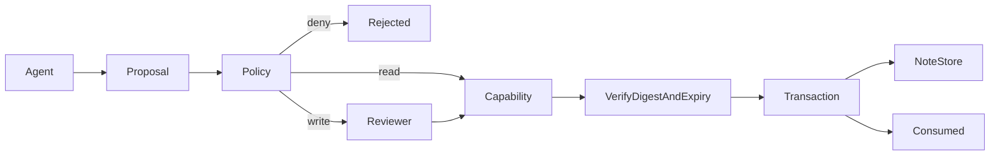

# Architecture and extension points

## Data flow

## Module boundaries

`app/main.py` owns Pydantic contracts and HTTP behavior. The domain module owns scoring, retrieval, authorization, evaluation or privacy state. `app/platform.py` owns bounded HTTP bodies, local trust checks, metadata audit persistence and frontend mounting. The React workbench is a client of the same public API documented by FastAPI.

SQLite transactions use parameterized queries and close their connections at scope exit. WAL is selected for local read/write concurrency. Domain state and audit records are separate concerns: the audit append is not generally atomic with a domain state change. Deploy one process for Privacy Relay's in-memory vault.

## Decisions

| Decision | Reason | Tradeoff |
| --- | --- | --- |
| Small independent repository | Easy to clone, review, run and extend | Common workbench infrastructure is duplicated |
| FastAPI + React | Typed request validation and familiar full-stack interfaces | Shared types are not code-generated yet |
| SQLite | Zero external service and deterministic fixtures | Not a high-throughput multi-tenant design |
| Offline default | Reproducible demos without credentials or paid inference | Does not prove behavior of a live model |
| Inspectable algorithms | Failures can be explained during review | Baselines have documented recall/precision limits |

## Extension plan

1. 接入 OIDC，服务端映射 principal → scope，并使用单独的审批应用。
2. 把能力授权拓展为带污点来源的数据流策略，限制间接注入驱动的工具组合。
3. 支持外部工具的事务 outbox、补偿操作、预算限制与取消；避免将本地事务语义误用到外部副作用。

Before implementing an extension, define its acceptance metric, failure budget and comparison baseline. Keep transport errors separate from successful defenses and keep external validation data separate from development fixtures.
